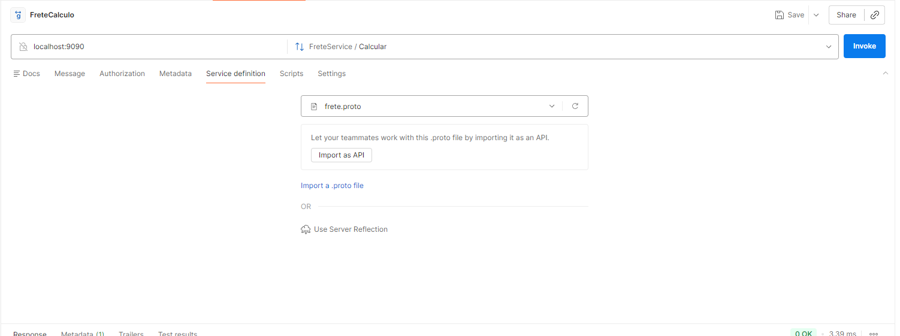
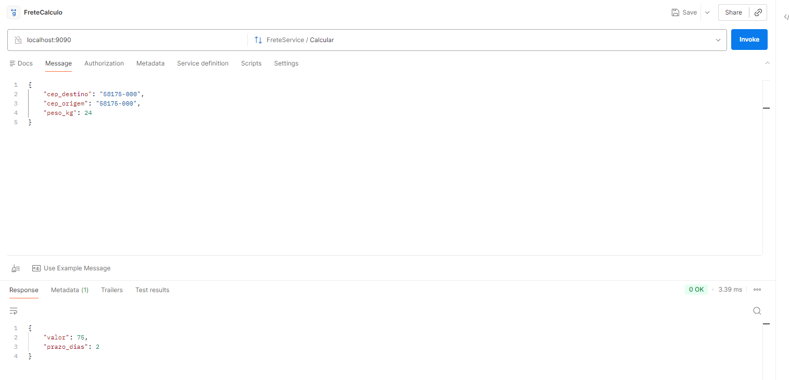

# Serviço de Frete gRPC

Serviço gRPC em Spring Boot que calcula o **valor** e o **prazo de entrega** de um frete a partir dos CEPs de origem e destino e do peso da encomenda.

## Tecnologias

- Java 21
- Spring Boot 4.2 com Spring gRPC (`spring-boot-starter-grpc-server`)
- Protocol Buffers (`protobuf-maven-plugin`)
- Maven (via Maven Wrapper)

## Contrato (`src/main/proto/frete.proto`)

```proto
service FreteService {
  rpc Calcular(FreteRequest) returns (FreteResponse); // unário
}

message FreteRequest {
  string cep_origem = 1;
  string cep_destino = 2;
  double peso_kg = 3;
}

message FreteResponse {
  double valor = 1;
  int32 prazo_dias = 2;
}
```

### Regra de cálculo

- **Valor:** `15.0 + peso_kg * 2.5`
- **Prazo:** 2 dias se os CEPs de origem e destino começam com o mesmo dígito (mesma região), senão 5 dias.

## Como executar

```bash
./mvnw spring-boot:run
```

No Windows (cmd/PowerShell), use `mvnw.cmd spring-boot:run`.

O servidor gRPC sobe na porta **9090**, configurada em `src/main/resources/application.properties`.

> As classes Java do contrato (`FreteRequest`, `FreteResponse`, `FreteServiceGrpc`) são geradas a partir do `.proto` durante o build, em `target/generated-sources/protobuf`. Depois de alterar o `.proto`, rode `./mvnw compile` para gerá-las de novo.

## Testando no Postman

No Postman, crie uma nova requisição (**New**) e escolha o tipo de requisição **gRPC**. Depois siga os passos abaixo.

### 1. Configurar o servidor e a definição do serviço

- Em **URL**, informe `localhost:9090`.
- Na aba **Service definition**, clique em **Import a .proto file** e selecione o arquivo `src/main/proto/frete.proto`.
- No seletor de método, escolha **FreteService / Calcular**.



### 2. Montar a mensagem e invocar

- Na aba **Message**, informe o corpo da requisição em JSON:

```json
{
  "cep_origem": "58175-000",
  "cep_destino": "58175-000",
  "peso_kg": 24
}
```

- Clique em **Invoke**. A resposta aparece embaixo, com status `0 OK`:

```json
{
  "valor": 75,
  "prazo_dias": 2
}
```


